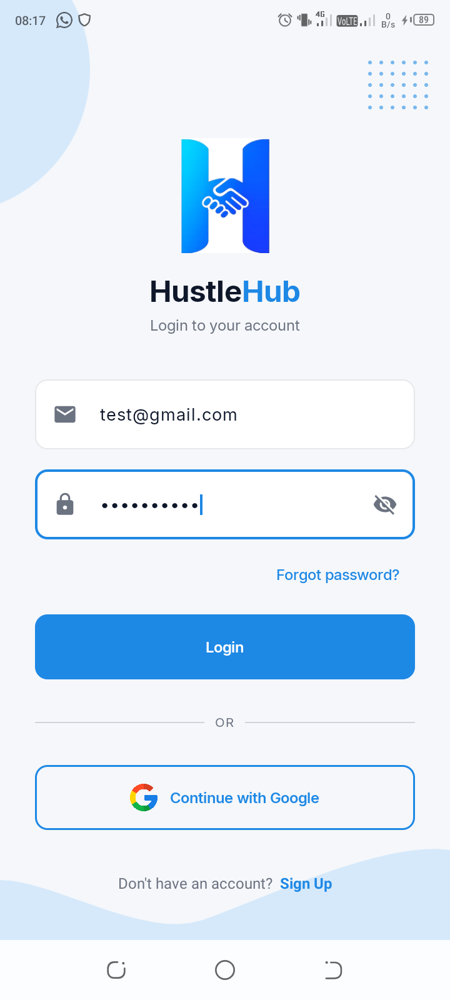
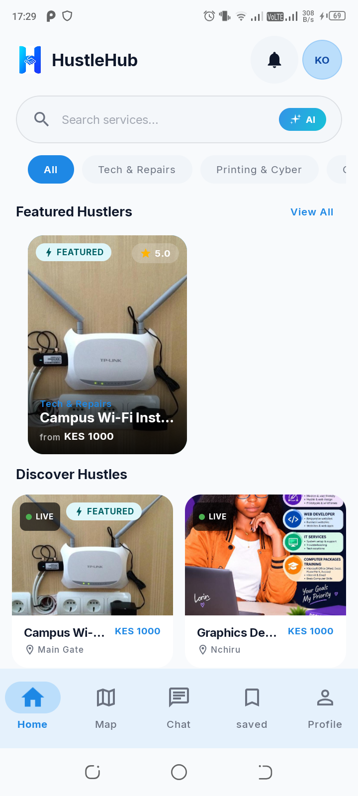
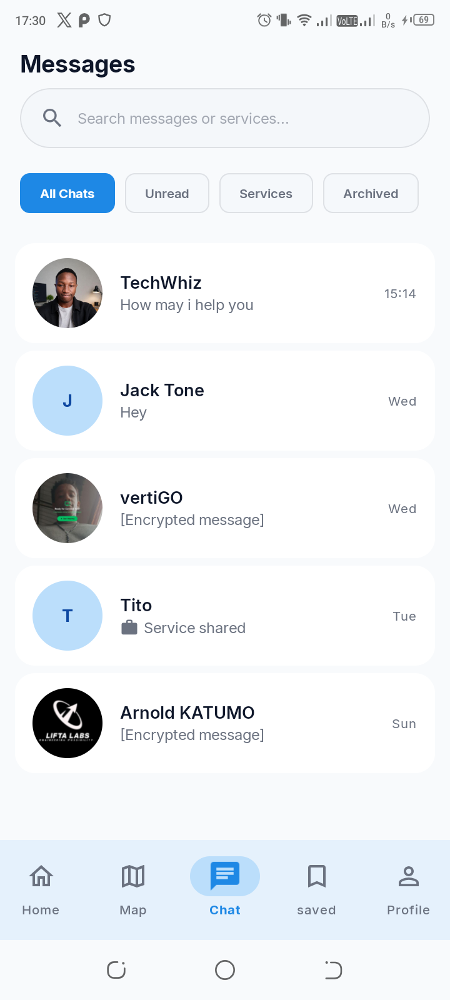
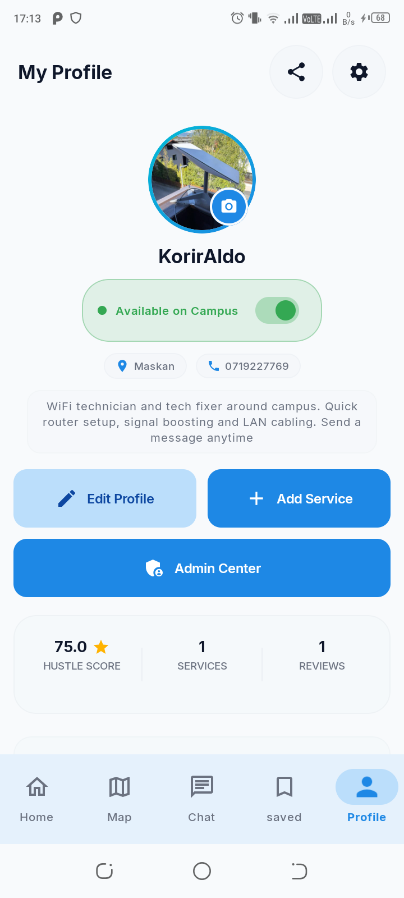

# 🚀 HustleHub

<div align="center">


**Your Campus Marketplace**

[](https://www.android.com)
[](https://kotlinlang.org)
[](https://developer.android.com/jetpack/compose)
[](https://spring.io/projects/spring-boot)
[](LICENSE)
[](docs/CONTRIBUTING.md)

*Connecting campus hustlers with customers through trust, convenience, and innovation*

[Features](#-features) • [Tech Stack](#-tech-stack) • [Getting Started](#-getting-started) • [Contributing](#-contributing) • [Roadmap](#-roadmap)

</div>

---

## 📖 About

**HustleHub** is a native Android marketplace app that transforms the informal peer-to-peer service economy at Meru University of Science & Technology. Students offer laundry, salon, tutoring, graphic design, food, and more — but currently rely on chaotic WhatsApp groups and word of mouth.

HustleHub organizes this economy into a structured, trustworthy platform with:

- 🔍 **AI-powered search** — "braids near Gate B under 500"
- 💬 **Safe in-app messaging** — no phone number sharing required
- 🗺️ **Campus map** — real-time provider locations
- ⭐ **Reputation system** — ratings, reviews, and trust scores
- 🎓 **Student-only access** — verified via university email
- 📸 **Portfolio showcase** — providers display their work

---

## ✨ Features

### Core Features (v1.0)

**Authentication & Onboarding**: Student email signup (@must.ac.ke), email verification, Google Sign-In, zero-friction customer browsing, and provider profile setup.

**Service Management**: Create and edit listings with portfolio images, category selection, price range, availability toggle (Available / Busy / Offline), and verified Pro provider badges.

**Discovery & Bookmarks**: Browse by category, instant text search, **AI-powered natural language search** via Gemini, sort by relevance / rating / distance, and save favorite services in the dedicated **Saved** tab.

**Encrypted Messaging**: Real-time 1-on-1 end-to-end encrypted (E2EE) chat (ECDH + AES-256-GCM), voice notes with waveform and proximity earpiece routing, image sharing, location sharing, Service Request Cards, typing indicators, read receipts, and FCM push notifications.

**Campus Map**: Google Maps with provider pins color-coded by category, pin clustering, distance-based discovery, and quick-action bottom sheets.

**Ratings & Reviews**: 5-star ratings, written reviews with image attachments, moderation reporting, and post-service prompts.

**Monetization & Pro Tiers**: HustleHub Pro provider subscriptions and featured listing boosts via M-Pesa STK Push.

**Administration & Safety**: Native in-app Admin Dashboard with platform telemetry, report resolution, and user suspension controls.

### Future Features (Post-MVP Roadmap)

- 📞 In-app voice/video calls (WebRTC)
- 🏆 Gamified Hustle Score, badges, leaderboards
- 🏫 Multi-campus expansion (Kenyatta, UoN, etc.)
- 🔄 Service swap / barter matching

---

## 🛠️ Tech Stack

### Android Client
- **Language**: Kotlin 2.x
- **UI**: Jetpack Compose + Material 3 Expressive
- **Architecture**: MVVM + Clean Architecture (feature-based)
- **Navigation**: Navigation 3 (`androidx.navigation3`)
- **DI**: Hilt (Dagger)
- **Networking**: Retrofit 3.0.0 + OkHttp 5.x
- **Real-time Chat**: OkHttp WebSocket client → Spring Boot WebSocket/STOMP
- **Local Cache**: Room 2.8.4 + DataStore Preferences (offline-first)
- **Image Loading**: Coil 2.7.0
- **State**: Kotlin Flow + StateFlow

### Backend & Infrastructure
- **REST API**: Spring Boot (Kotlin) — all data at `/api/v1/`
- **Real-time**: Spring WebSocket / STOMP — live chat and presence
- **Authentication**: Firebase Auth (Email/Password + Google Sign-In)
- **Push Notifications**: Firebase Cloud Messaging (FCM)
- **AI Search**: Gemini API (invoked server-side)
- **Maps**: Google Maps SDK for Android

> ⚠️ **No Firestore, no Firebase Realtime Database, no Supabase.** All application data is served by the Spring Boot backend. Firebase is used exclusively for Auth and FCM.

---

## 🏗️ Architecture

```
Android Client
├── Presentation (Compose + ViewModels)
├── Domain (Use Cases + Repository Interfaces)
└── Data (Retrofit APIs + Room Cache + WebSocket)
        │
        ▼ REST /api/v1/ + WebSocket
Spring Boot Backend
├── REST API (services, discovery, chat, users, reviews, media)
├── WebSocket Server (real-time chat)
├── Gemini AI Service (natural language search)
└── Database + File Storage
        │
Firebase (Auth + FCM only)
```

### Package Structure
```
must.kdroiders.hustlehub/
├── activities/              # MainActivity (hosts HustleHubNav & deep links)
├── appHilt/                 # HustleHubApp (@HiltAndroidApp)
├── core/                    # Cross-cutting: api, auth, cache, crypto, deeplink, realtime, telemetry, worker
├── data/local/              # Room database, DAOs, entities (offline cache)
├── datastore/               # DataStore preferences (user role, first launch, auth state)
├── di/                      # Hilt DI modules (NetworkModule, FirebaseModule, RepositoryModule, CoilModule)
├── navigation/              # Navigation 3 (NavKeys, HustleHubNavGraph, 5 bottom tabs, MainScaffold)
├── onboarding/              # First-launch onboarding carousel
├── sharedComposables/       # Design system library (HustleButton, HustleCard, HustleTextField, ...)
├── splash/                  # Auth-gate splash screen
└── ui/features/             # Clean Architecture feature slices (data/, domain/, presentation/)
    ├── admin/               # Mobile admin dashboard, moderation & audit logs
    ├── analytics/           # Service & search performance telemetry
    ├── auth/                # Email/password signup, OTP verification, Google Sign-In
    ├── bookmarks/           # Saved services (BottomBookmarks tab)
    ├── chat/                # Real-time E2EE messaging, audio routing & STOMP sync
    ├── help/                # Campus FAQs & student support guides
    ├── home/                # Discovery feed, AI natural language search, categories
    ├── map/                 # Campus map with clustered provider pins
    ├── media/               # Multi-part image & voice uploads
    ├── monetization/        # HustleHub Pro subscriptions & M-Pesa STK push
    ├── notification/        # FCM push notifications & in-app alerts
    ├── privacy/             # Data export & account deletion
    ├── profile/             # User & provider profiles, reviews, settings
    ├── report/              # User/service safety reports
    └── service/             # Service CRUD & availability toggle
```

See [ARCHITECTURE.md](docs/dev/ARCHITECTURE.md) for full detail.

---

## 🚀 Getting Started

### Prerequisites

- Android Studio Ladybug (or latest stable)
- JDK 17+
- Firebase account (Auth + FCM only)
- Google Cloud account (Maps API key)
- **HustleHub Spring Boot backend** running locally

### Installation

1. **Clone the Android repo**
   ```bash
   git clone git@github.com:Android-Community-MUST/kotlin-hustlehub.git
   cd kotlin-hustlehub
   ```

2. **Clone and start the Spring Boot backend**
   ```bash
   git clone git@github.com:Android-Community-MUST/hustlehub-backend.git
   cd hustlehub-backend
   ./gradlew bootRun   # starts on localhost:8080
   ```

3. **Set up Firebase (Auth + FCM only)**
   - Create a Firebase project at [console.firebase.google.com](https://console.firebase.google.com)
   - Add Android app with package `must.kdroiders.hustlehub`
   - Download `google-services.json` → place in `app/`
   - Enable **Authentication** (Email/Password + Google Sign-In)
   - Enable **Cloud Messaging** (auto-enabled)
   - ❌ Do NOT enable Firestore, Realtime Database, or Storage

4. **Configure API keys**
   ```bash
   cp keys.properties.template keys.properties
   ```
   Edit `keys.properties`:
   ```properties
    MAPS_API_KEY=AIzaSy...your_maps_key
    BASE_URL=http://10.0.2.2:8080/api/v1/
    WS_BASE_URL=ws://10.0.2.2:8080/ws
    GEMINI_API_KEY=AIzaSy...your_gemini_key
    GOOGLE_WEB_CLIENT_ID=your_google_web_client_id_here
    ```

5. **Build and run**
   ```bash
   ./gradlew installDebug
   ```

See [SETUP.md](docs/dev/SETUP.md) for full setup instructions.

---

## 📱 Screenshots

<div align="center">

| Login | Home / Discovery | Chat | Profile |
|:---:|:---:|:---:|:---:|
|  |  |  |  |

</div>

---

## 🤝 Contributing

1. Fork the repo and create a feature branch: `git checkout -b feature/amazing-feature`
2. Follow [Kotlin coding conventions](https://kotlinlang.org/docs/coding-conventions.html)
3. Run quality checks before committing:
   ```bash
   ./gradlew ktlintCheck detekt test
   ```
4. Use Conventional Commits: `feat(chat): add typing indicators`
5. Open a Pull Request against `develop`

See [CONTRIBUTING.md](docs/CONTRIBUTING.md) for full guidelines.

---

## 📅 Roadmap & Current Status

### ✅ Phase 1: MVP — Complete (Ready for Production)
- [x] Authentication & profile setup (Firebase Auth + Spring Boot backend sync)
- [x] Design system & shared composables (Material 3 Expressive)
- [x] Service creation & discovery feed (categories, filtering, search)
- [x] AI-powered natural language search (Gemini API)
- [x] End-to-end encrypted messaging (ECDH + AES-256-GCM over STOMP WebSocket)
- [x] Voice notes with waveform and proximity earpiece audio routing
- [x] Campus map with color-coded provider pins and clustering
- [x] Ratings & reviews system with post-service prompt
- [x] Deep linking & profile sharing
- [x] Closed testing track completed (20+ active testers for 17+ days)
- [x] Production application submitted to Google Play Console (`v1.0.4`, Build 8)

### 🚀 Phase 2: Growth & Monetization (Shipped & Active)
- [x] In-app M-Pesa STK Push integration & subscription tier (`HustleHub Pro`)
- [x] Provider & platform analytics dashboard
- [x] Native in-app Admin moderation & user management center
- [ ] In-app voice/video calls (WebRTC)
- [ ] Gamification (Hustle Score, badges, leaderboards)

### 🔮 Phase 3: Scale (Post-Launch)
- [ ] Multi-campus expansion (Kenyatta University, UoN, etc.)
- [ ] Service swap / barter matching
- [ ] Emergency request broadcasts

---

## 🧪 Testing

```bash
# Unit tests
./gradlew test

# Instrumented tests (requires emulator/device + backend running)
./gradlew connectedAndroidTest

# Code quality
./gradlew ktlintCheck detekt
```

**Test coverage targets**: 70%+ for domain and data layers, critical UI flows covered.

---

## 📄 Documentation

| Document | Description |
|----------|-------------|
| [PRD.md](docs/PRD.md) | Full product requirements |
| [ARCHITECTURE.md](docs/dev/ARCHITECTURE.md) | Codebase structure and patterns |
| [API.md](docs/dev/API.md) | Spring Boot REST + WebSocket API reference |
| [SETUP.md](docs/dev/SETUP.md) | Development environment setup |
| [TROUBLESHOOTING.md](docs/dev/TROUBLESHOOTING.md) | Common issues and solutions |
| [CHANGELOG.md](docs/dev/CHANGELOG.md) | Version history |
| [CONTRIBUTING.md](docs/CONTRIBUTING.md) | Contribution guidelines |

---

## 🔒 Privacy & Security

- **Student verification**: Only @must.ac.ke emails allowed
- **Token security**: All API calls use short-lived Firebase ID tokens (auto-refreshed)
- **No phone number sharing**: In-app messaging only
- **User safety**: Block/report features, content moderation, in-app safety tips
- **Privacy Policy**: [View Policy](PRIVACY.md)

---

## 👥 Team & Contributors

Built and maintained with ❤️ by the **Android Community MUST** engineering team at Meru University of Science & Technology:

- **Korir Aldo** — [@korryrdev](https://github.com/korryrdev) — *Lead Android Engineer & Backend Architect*
- **Vertigo** — [@vertigo0628](https://github.com/vertigo0628) — *Android Developer*
- **Botmaster Kenya** — [@Botmasterkenya](https://github.com/Botmasterkenya) — *Android Developer*
- **Nancy** — [@NancyN00](https://github.com/NancyN00) — *Android & KMP Developer*
- **Rose** — [@Rose-Apex](https://github.com/Rose-Apex) — *Android Developer*

---

## 📜 License

Proprietary & Confidential License — see [LICENSE](LICENSE) for details.

---

## 🙏 Acknowledgments

- [Meru University of Science & Technology](https://must.ac.ke) for the inspiration
- [Spring Boot](https://spring.io) + [Kotlin](https://kotlinlang.org) for the backend
- [Jetpack Compose](https://developer.android.com/jetpack/compose) for the UI toolkit
- [Firebase](https://firebase.google.com) for Auth and FCM
- [Google AI](https://ai.google.dev) for Gemini API
- All beta testers and early adopters

---

<div align="center">

**Built with ❤️ by campus hustlers, for campus hustlers**

[⬆ Back to Top](#-hustlehub)

</div>
