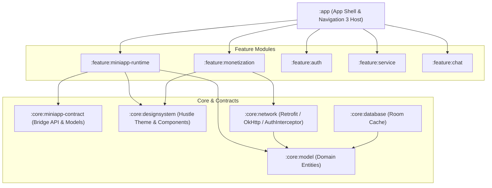

# 02. Why a Multi-Module Architecture is Required

This document explains why transitioning HustleHub from its current single-module monolith into a **Multi-Module Architecture** is an architectural prerequisite for supporting a stable, secure Super App platform.

---

## 🏛️ The Current State: The Single-Module Monolith

In [settings.gradle.kts](file:///home/korryr/StudioProjects/kotlin-hustlehub/settings.gradle.kts), HustleHub is currently configured as a single module:

```kotlin
rootProject.name = "HustleHub"
include(":app")
```

Inside `app/src/main/java/must/kdroiders/hustlehub/`, all 17 feature packages (`service`, `chat`, `map`, `monetization`, `auth`, `admin`, etc.), the local database, network clients, navigation graph, and design system live inside the **same compilation unit**.

```
[ :app (Monolith) ]
├── core/ (api, auth, crypto, realtime, telemetry)
├── data/local/ (Room DB, DAOs, Entities)
├── di/ (Hilt Dependency Injection modules)
├── navigation/ (Navigation 3 graph & keys)
├── sharedComposables/ (M3 Design System)
└── ui/features/ (17 feature slices: auth, chat, map, service, monetization...)
```

While clean feature-slicing was maintained using Clean Architecture folders, this structure becomes an **engineering bottleneck** when introducing a Super App platform.

---

## ⚠️ Why the Monolith Breaks Under a Super App Model

### 1. Zero Compile-Time Boundaries (The "Accidental Leak" Risk)
In a single `:app` module, any Kotlin file can import any other Kotlin file unless explicitly prevented. 
* A developer working on the `miniapp` container could accidentally import internal Room DAOs, private crypto keys, or internal network interceptors.
* **In a Super App, isolation must be enforced by the compiler, not developer discipline.**

### 2. High Blast Radius & Fragility
A Super App's Host Shell must be rock-solid. If a bug is introduced in a peripheral feature (e.g., Bookmarks or Help FAQ), it should never be able to destabilize the core `Auth`, `M-Pesa Payment Rail`, or `Mini-App Runtime`. In a monolith, all code shares the same classpath, Hilt graph, and lifecycle scope.

### 3. Explosive Build Times
As mini-app capabilities expand, every code change in the monolithic `:app` forces Gradle and KSP (Kotlin Symbol Processing) to re-process Room schemas, Hilt graphs, and Compose compiler metrics across the entire application.
* **Monolith Build**: 2 to 4+ minutes per clean build.
* **Multi-Module Build**: Under 30 seconds for incremental builds, because Gradle compiles unchanged modules in parallel and pulls from the local build cache.

### 4. Inability to Extract a Standalone "HustleHub Mini-App SDK"
To enable external student developers to write mini-apps, we need to provide a lightweight contract library (e.g. data models, bridge contracts, mock test harness). In a monolith, extracting that contract is impossible without bringing along Firebase, Retrofit, Room, and the entire app's transitive dependencies.

---

## 📐 The Target Multi-Module Architecture

To host mini-apps cleanly, HustleHub will evolve toward a **layer-based modular architecture** following Google's official Android Architecture guidelines:



---

## 🧩 Module Responsibilities Breakdown

### 1. `:core:model` (Pure Kotlin / Android)
* Contains shared domain entities (e.g., `StudentProfile`, `PaymentReceipt`, `CampusLocation`).
* Zero external dependencies (no Retrofit, no Room, no Compose).

### 2. `:core:miniapp-contract` (Public Platform Contract)
* Contains the interfaces and data contracts for the Mini-App platform:
  * `HustleBridgeAction` (sealed class of actions a mini-app can request).
  * `MiniAppManifest` (metadata, entry URL, required permissions).
  * `MiniAppPermission` (enum: `USER_PROFILE`, `PAYMENT`, `LOCATION`).
* This module can be published or shared with mini-app developers as their reference contract.

### 3. `:feature:miniapp-runtime` (The Sandbox Engine)
* Contains the native Compose screen (`MiniAppContainerScreen`), the hardened Android `WebView`, the JavaScript-to-Native bridge implementation, and the permission dialogs.
* **Crucial boundary:** It depends **only** on `:core:miniapp-contract`, `:core:designsystem`, and navigation keys. It has **no access** to internal feature implementations.

### 4. `:feature:monetization` (The Native Payment Rail)
* Houses the Safaricom Daraja STK push logic, M-Pesa phone normalization, and payment status polling.
* When a mini-app requests a payment, the host routes the request to this module via an abstract callback or navigation key.

### 5. `:app` (The Thin Application Orchestrator)
* Contains `MainActivity`, the root Hilt application class (`HustleHubApp`), and the top-level Navigation 3 backstack.
* It binds all the feature modules together into the final signed APK.

---

## 🛡️ The "Golden Rules" of Modularization for HustleHub

1. **Features Never Depend on Features:**
   * `:feature:miniapp-runtime` must **never** import `:feature:monetization` or `:feature:chat`.
   * Cross-feature coordination is done via Navigation 3 `NavKey` contracts or shared event flows in `:core`.
2. **Strict Inversion of Control:**
   * Core modules never know who is using them.
   * High-level modules depend on abstractions defined in lower-level contracts.
3. **Incremental Migration:**
   * We do not rewrite the entire app in one go. We create the `:feature:miniapp-runtime` and `:core:miniapp-contract` modules first, leaving existing monolithic features untouched until needed.
