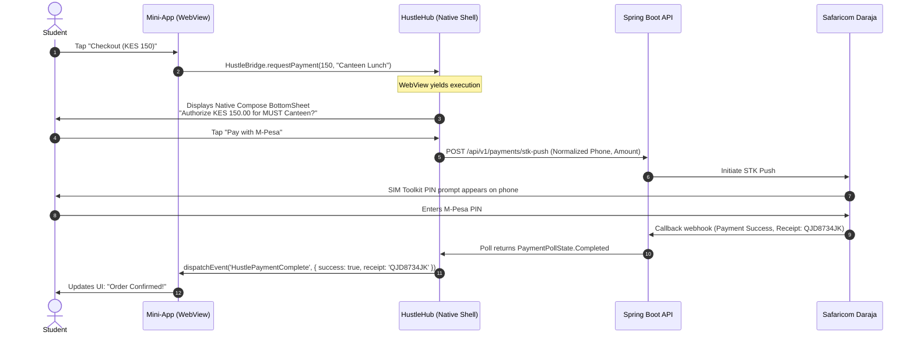

# 03. Runtime, Bridge & Security Specification

This document provides the definitive engineering specification for the **Mini-App Web-Sandbox Container**, the **JavaScript-to-Native Bridge (`HustleBridge`)**, the **M-Pesa Payment Mediation Protocol**, and the **Security Sandbox**.

---

## 🔒 1. Android WebView Hardening Specification

The mini-app container runs inside a Jetpack Compose `AndroidView` wrapping an Android `WebView`. To prevent malicious web scripts from accessing local device storage or executing unauthorized code, the WebView must be configured according to high-security zero-trust standards.

```kotlin
@Composable
fun MiniAppContainerScreen(
    entryUrl: String,
    appId: String,
    onPaymentRequested: (PaymentRequest) -> Unit,
    onClose: () -> Unit
) {
    AndroidView(
        factory = { context ->
            WebView(context).apply {
                settings.apply {
                    // 1. Enable modern web standards
                    javaScriptEnabled = true
                    domStorageEnabled = true
                    
                    // 2. Strict Zero-Trust Security Settings
                    allowFileAccess = false               // Block file:// access
                    allowContentAccess = false            // Block content:// access
                    allowFileAccessFromFileURLs = false   // Block local XSS
                    allowUniversalAccessFromFileURLs = false
                    mixedContentMode = WebSettings.MIXED_CONTENT_NEVER_ALLOW // Force HTTPS
                    
                    // 3. Performance & Caching
                    cacheMode = WebSettings.LOAD_DEFAULT
                    setSupportZoom(false)
                }

                // 4. Bind Custom WebViewClient to handle intent schemes (M-Pesa, tel)
                webViewClient = SecureMiniAppWebViewClient(allowedHostPattern = "*.must.ac.ke")
                
                // 5. Inject the Native Bridge
                addJavascriptInterface(
                    HustleBridgeImpl(appId, context, onPaymentRequested, onClose),
                    "HustleBridge"
                )

                loadUrl(entryUrl)
            }
        },
        update = { webView ->
            // Update logic on recomposition
        }
    )
}
```

### URL Scheme Interceptor (`SecureMiniAppWebViewClient`)
Third-party web gateways frequently attempt to launch external apps via custom schemes (`tel:`, `mailto:`, `mpesa:`, `intent:`). The container must safely trap and forward these:

```kotlin
class SecureMiniAppWebViewClient(
    private val allowedHostPattern: String
) : WebViewClient() {

    override fun shouldOverrideUrlLoading(view: WebView, request: WebResourceRequest): Boolean {
        val url = request.url.toString()
        
        // Handle telephony and external intents safely
        if (url.startsWith("tel:") || url.startsWith("mailto:")) {
            val intent = Intent(Intent.ACTION_VIEW, Uri.parse(url))
            view.context.startActivity(intent)
            return true
        }

        // Validate origin: Prevent unverified redirects to external phishing domains
        val host = request.url.host ?: return true
        if (!host.endsWith("must.ac.ke") && !isWhitelistedDomain(host)) {
            Timber.w("Blocked navigation to untrusted domain: $host")
            return true // Abort navigation
        }

        return false // Proceed loading allowed HTTPS page
    }
}
```

---

## 🌉 2. The `HustleBridge` Protocol Specification

Mini-apps communicate with the native HustleHub host via a standardized JavaScript object injected into the global `window` object: `window.HustleBridge`.

### JavaScript SDK Interface (`hustlehub-sdk.js`)
External student developers include this standard script in their web applications:

```javascript
/**
 * Official HustleHub Mini-App SDK
 */
const HustleHub = {
  // 1. Fetch authenticated student's public info (NO passwords, NO master tokens)
  getStudentProfile: async () => {
    return JSON.parse(window.HustleBridge.getStudentProfile());
  },

  // 2. Trigger native M-Pesa payment
  payWithMpesa: (amount, memo, reference) => {
    return new Promise((resolve, reject) => {
      const callbackId = "cb_" + Date.now();
      
      // Register one-time listener for result
      window.addEventListener("HustlePaymentComplete", function handler(e) {
        if (e.detail.callbackId === callbackId) {
          window.removeEventListener("HustlePaymentComplete", handler);
          if (e.detail.success) {
            resolve(e.detail.receipt);
          } else {
            reject(new Error(e.detail.errorMessage));
          }
        }
      });

      // Dispatch request to native host
      window.HustleBridge.requestPayment(amount, memo, reference, callbackId);
    });
  },

  // 3. Close the mini-app and return to HustleHub home
  close: () => {
    window.HustleBridge.close();
  }
};
```

### Kotlin Native Implementation
```kotlin
class HustleBridgeImpl(
    private val appId: String,
    private val context: Context,
    private val onPaymentRequested: (PaymentRequest) -> Unit,
    private val onClose: () -> Unit
) {
    @JavascriptInterface
    fun getStudentProfile(): String {
        // Return ONLY public profile data
        val profile = MiniAppStudentProfile(
            studentId = "CT201/0001/22",
            name = "John Doe",
            campus = "Meru University - Main Campus",
            department = "Computer Science"
        )
        return Json.encodeToString(profile)
    }

    @JavascriptInterface
    fun requestPayment(amount: Double, memo: String, reference: String, callbackId: String) {
        // Yield to Native Jetpack Compose UI (Runs on Android Main Thread)
        Handler(Looper.getMainLooper()).post {
            onPaymentRequested(
                PaymentRequest(
                    appId = appId,
                    amount = amount,
                    memo = memo,
                    reference = reference,
                    callbackId = callbackId
                )
            )
        }
    }

    @JavascriptInterface
    fun close() {
        Handler(Looper.getMainLooper()).post {
            onClose()
        }
    }
}
```

---

## 💳 3. Native M-Pesa Mediation Sequence

The mini-app **never** handles or sees the student's M-Pesa PIN, phone number, or payment credentials. The host shell mediates the transaction end-to-end:



---

## 🛡️ 4. Security Sandbox & Threat Model

| Threat | Impact | Architectural Countermeasure |
| :--- | :--- | :--- |
| **Token Theft / Impersonation** | Malicious mini-app steals user's Firebase Auth token | **Token Isolation**: The host **never** passes the user's master JWT or Firebase ID token to the WebView. If a mini-app requires backend authentication, the host issues an ephemeral, scoped token (`aud = "miniapp:<appId>"`). |
| **Silent Transactions** | Mini-app script triggers unauthorized payments in a loop | **Mandatory Native Confirmation**: The JS Bridge cannot trigger a payment directly; it can only request the host to pop a native modal requiring explicit student confirmation. |
| **Phishing / Rogue Navigation** | Mini-app redirects to a lookalike login page | **Strict Host Whitelisting**: `shouldOverrideUrlLoading` blocks any navigation outside approved `.must.ac.ke` domains or registered partner hosts. |
| **Local File Inspection** | Malicious script attempts to read HustleHub's Room database | **Zero File Access**: `allowFileAccess = false`, `allowContentAccess = false`, and private app data directories are excluded from WebView scope. |

---

## 📜 5. Google Play Store Compliance Blueprint

Google Play enforces strict policies regarding WebViews and Payments. To ensure HustleHub remains in 100% good standing:

1. **Permitted Transactions (Real-World & Physical Services)**:
   * Google Play Developer Policy explicitly allows third-party payment rails (like M-Pesa / Daraja) for **physical goods and services delivered outside the digital app**:
     - Campus cafeteria food delivery ✅
     - Physical document printing services ✅
     - Laundry and salon bookings ✅
     - Physical campus event tickets ✅
2. **Prohibited Transactions (Digital Content)**:
   * Mini-apps **must not** sell digital goods consumed inside the app (e.g. digital PDF notes, virtual currency, app badges) using M-Pesa. Digital goods must use **Google Play In-App Billing**.
3. **Webview Policy (No "Spam / Webview Wrappers")**:
   * Google Play penalizes apps whose primary purpose is to be a single website wrapper. 
   * HustleHub is compliant because the primary application is a rich, native Jetpack Compose application with local Room caching, native maps, native chat, and background push notifications; mini-apps are subordinate extensions within an authenticated platform.
